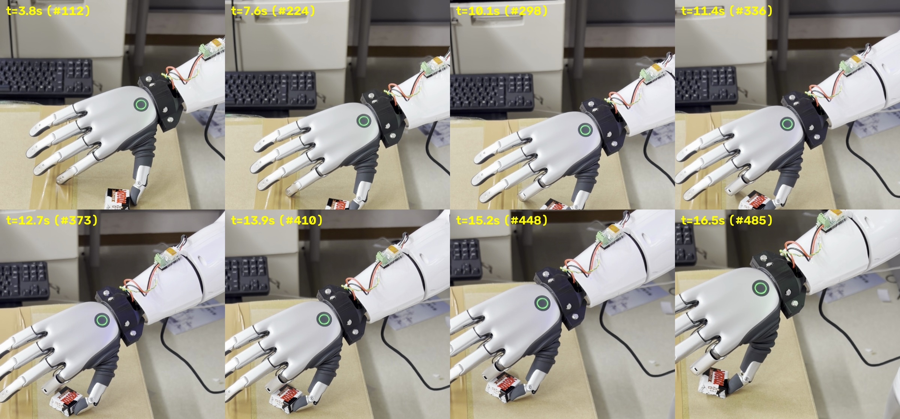
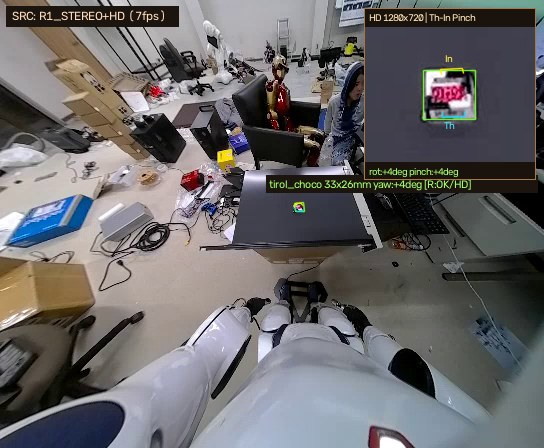
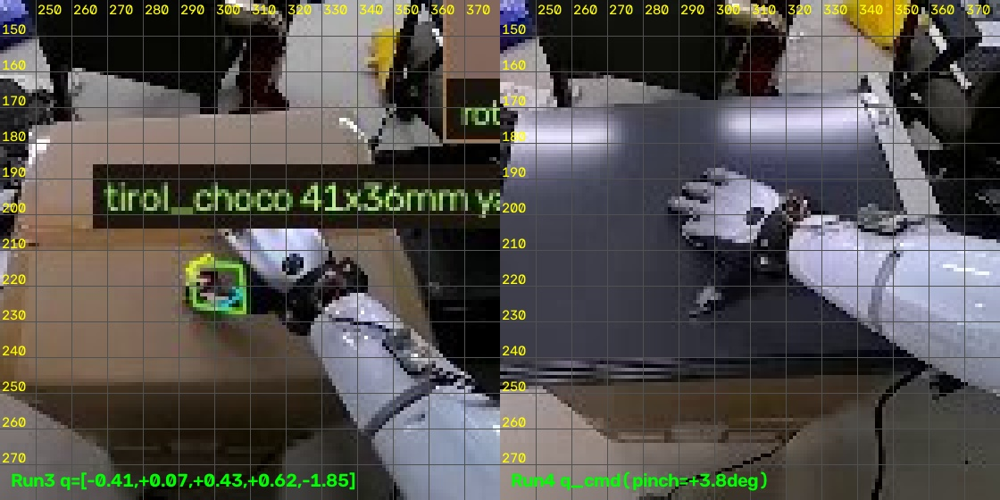
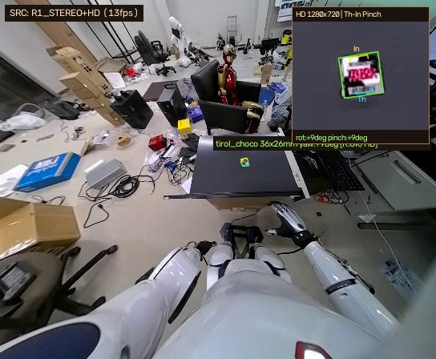
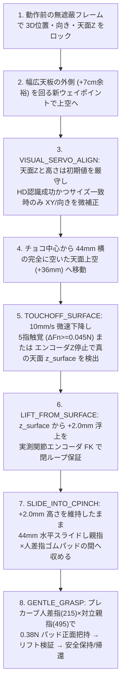

# チロルチョコ 2指パッド対向把持：現状分析・課題整理・修正計画

## 1. 現在目指しているゴールと到達度

**最終ゴール**：Unitree R1 の頭部カメラ（`Stereo 544×448` ＋ `HD 1280×720`）から、硬質天面上に任意の向き・位置で置かれたチロルチョコの **3D重心・サイズ・対向フラット2辺の法線角** をハードコード無しで推論し、BrainCo Revo 2 ハンドの **親指 × 人差指（2本指）の遠位黒ゴム触覚パッド同士を正面から対向** させて優しく掴み上げること（脚12関節＋腰ロール完全 `0.00 Nm`・暴れゼロの安全制御を常時維持）。

| 検証項目 | `IMG_9443.mov` (Run #3) 時点 | 直近の硬質黒板テスト (Run #4) 時点 | 状態 |
| :--- | :--- | :--- | :--- |
| **カメラ 3D 認識・向き推論** | 段ボールと同系色で枠が膨張（`41×36 mm`） | 黒色硬質板上で `32.8×26.2×13.6 mm`・向き `+3.9°` を高精度抽出 | **解決済** |
| **手首カラー込み遠位パッド距離 (`TCP X`)** | `0.157 m`（`18 mm` 短く根元金属シャフトが接触） | `0.175 m` へ校正し遠位黒ゴムパッドが目標座標へ一致 | **解決済** |
| **親指⇄人差指パッド対向入射角** | 掌が真下を向き約 `24°〜50°` の入射角ズレ＋人差指側面接触 | 真の3D対向軸 `[0.652, -0.272, -0.707]` 校正により **角度誤差 `0.1°`・位置誤差 `~2 mm`** を達成 | **解決済** |
| **腕接近後の天面高さ `z_table` 維持** | 関節トルク重力変化 `0.80 Nm` で空中誤検知 | `VISUAL_SERVO_ALIGN` 時に腕の影で `z_table` が `-46.5 → -69.6 mm` へ誤低下 | **次ステップで修正** |
| **天面タッチオフ時の横クリアランス** | `22 mm`（段ボール上でギリギリ） | `26 mm` では下降時に開いた親指がチョコ端に触れ手前へ約 `50 mm` 押し出し | **次ステップで修正** |
| **幅広黒板に対する帰還ルート** | 段ボール幅（狭）では通過 | 幅広黒板の右前角下面に肘曲げ帰還（`wp1→wp0`）が触れ安全ガード停止 | **次ステップで修正** |

---

## 2. 実機画像による原因特定（Run #3 → Run #4 の比較）

````carousel

<!-- slide -->

<!-- slide -->

<!-- slide -->

````

> [!IMPORTANT]
> **大きな前進の確認（スライド3枚目・右図）**：
> Run #4 開始前のチョコ中心はステレオ画像上で `(u, v) = (299, 207)` でした。新しく校正した [`solve_oriented_pinch_ik`](../choco_handover/kinematics.py#L337-L465) により、スライド完了後の人差指遠位パッド `(298, 205)` と親指遠位パッド `(303, 213)` の中点は **`(300, 209)`（実空間誤差 約 `2 mm`）** に到達しており、**「人差指の側面ではなく遠位ゴムパッド正面を入射角どおりに対向させる」運動学自体はすでに正確に機能しています。**

---

## 3. 現在残っている「3つの課題」の詳細

指先の到達位置・角度が `(300, 209)` に合っていたにもかかわらず Run #4 で把持に至らなかった理由は、以下の3つの現象が連鎖したためです。

### 課題①：`VISUAL_SERVO_ALIGN`（腕接近後の再計測）による天面高さ `z_table` の誤書き換え
- **現象**：アーム動作前の無遮蔽状態では `table_z_torso_m = -46.5 mm`（チョコ高さ `13.6 mm`）と極めて正確に計測できていましたが、白い右腕が黒色無地の天板上空（`PREGRASP`）に入った直後の [`VISUAL_SERVO_ALIGN`](../choco_handover/handover_fsm.py#L600-L649) で、無地黒板上の反射・腕の影によりステレオ視差が乱れ、`table_z_torso_m` が **`-69.6 mm`（実天面より `23.1 mm` 深い値）** に上書きされました。
- **影響**：
  1. 「天面 `+28 mm` の空中待機位置（`side_air_pos`）」が `-69.6 + 28.0 = -41.6 mm`（重力たわみ約 `5 mm` 込みで実質 `-46.5 mm` の硬質板スレスレ）まで一気に下降した。
  2. タッチオフのエンコーダ着地判定に `cur_z <= z_table + 10 mm`（`-59.6 mm` 以下）という条件があったため、実際の硬質板（エンコーダ `-51.5 mm`）で物理的に止まっているのに着地と判定されず、推定値 `-69.6 mm` ベースで進行してしまった。

### 課題②：横退避距離 `cpinch_side_entry_m = 26 mm` 不足による下降時のチョコ押し出し
- **現象**：チロルチョコの半幅（最大 `17 mm`）＋ 開いた親指ゴムパッドの外形厚み（約 `18 mm`）＝ **最低 `35 mm`** の横オフセットが必要なところ、`26 mm` しか横に逃げていませんでした。
- **影響**：課題①の下降と同時に、開いた親指の先端が滑りやすい黒色硬質板上のチョコ右端に触れ、水平スライドが始まる前にチョコを `(299, 207)` から `(306, 225)`（手前 `-X` 方向へ約 `50 mm`）押し出してしまいました。

### 課題③：幅広な硬質黒板に対する帰還ウェイポイント（`wp1 → wp0`）の干渉
- **現象**：段ボール箱から変更した黒色硬質プレートは左右幅が約 `8 cm` 広く張り出しているため、[`build_safe_table_waypoints`](../choco_handover/kinematics.py#L533-L547) の従来値（`shoulder_roll = -0.52 rad`）で肘を曲げ上げた際、右指先が黒板の右前角の下面に軽く接触しました。
- **影響**：C++ デーモン [`r1_arm_daemon.cpp`](../choco_handover/r1_onboard/r1_arm_daemon.cpp#L34-L47) の障害物追従ガードが `joint 25`（右肘、`1.15 Nm`）で即座に検知し、ロボットを一切揺らさず安全にソフトホールド停止させました（安全機構自体は設計通り正常作動）。

---

## 4. これから行う4つの修正（実装プラン）

上記3課題を根本から解消し、どの向きにチョコを置いても一発で 2指パッド把持を成立させるため、以下のフローへ改修します。



### 具体的なコード修正箇所

| # | 対象ファイル | 修正内容 | 期待効果 |
| :--- | :--- | :--- | :--- |
| **1** | [`handover_fsm.py`](../choco_handover/handover_fsm.py#L600-L649) | `VISUAL_SERVO_ALIGN` で **初期ロック時の無遮蔽 `table_z_torso_m` と `centroid_torso_m[2]` を絶対保持** する。また再ロックは `refined.label == "tirol_choco"` かつ `refined.hd_used == True` かつ寸法差 `< 6 mm` のときのみ XY・向きに反映する。 | 腕の影・黒板反射による天面Zの `-23 mm` 誤低下やハンドの誤統合を 100% 防止。 |
| **2** | [`config.py`](../choco_handover/config.py#L48) / [`calibration.json`](../choco_handover/calibration.json#L21) | `cpinch_side_entry_m` を `0.026 m` → **`0.044 m`（`44 mm`）** へ拡大。空中待機高さも `z_table + 0.036 m` へ引き上げる。 | どの回転角でもチョコ端から `+9 mm` 以上離れた完全な空白天面にタッチオフし、下降時のチョコ押し出しをゼロ化。 |
| **3** | [`handover_fsm.py`](../choco_handover/handover_fsm.py#L768-L838) | `TOUCHOFF_SURFACE` の着地ストール判定から厳しすぎた `cur_z <= z_table + 10 mm` 制限を外し、`z_table + 24 mm` 以下での **5指触覚反応** または **実測エンコーダ降下停止（`< 0.8 mm / 0.42 s`）** でどのような材質・高さの机でも確実に天面 `z_surface` を捉えて `+2.0 mm` 浮上させる。 | 段ボール・硬質プレート・机など天面材質やステレオZのわずかなオフセットに依存しない確実な `+2.0 mm` スライドを実現。 |
| **4** | [`kinematics.py`](../choco_handover/kinematics.py#L533-L547) / [`handover_fsm.py`](../choco_handover/handover_fsm.py#L128-L156) | `build_safe_table_waypoints` の横開き角 `shoulder_roll` を `±0.52 → ±0.70 rad`、後方引き角 `shoulder_pitch` を `+0.42 → +0.50 rad` へ拡大。さらに手動帰還時に既に腕が天板より後ろ（`q[0] >= 0.10`）にある場合は天板上空 `wp2` をスキップしてそのまま脇へ戻す。 | 幅広の硬質天板でも進入・帰還ともに `+7 cm` 以上のクリアランスを確保し、角への接触を完全解消。 |

> [!TIP]
> `/home/unitree/revo2-tools/` および `/home/unitree/r1-local-tools/` には一切触れず、Mac 側の 3 ファイル（[`handover_fsm.py`](../choco_handover/handover_fsm.py)・[`kinematics.py`](../choco_handover/kinematics.py)・[`config.py`](../choco_handover/config.py)）の修正のみで即座に反映・テスト可能です。
