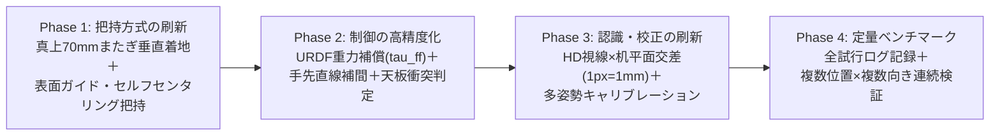

# 次期マスター作戦計画（v2）：誤差吸収型「表面拘束ピンチ」× 重力補償 × HD平面交差認識

Claude の分析は極めて本質を突いています。従来の「`2 mm` 浮かせて `44 mm` 横から滑り込ませる方式」は、ステレオ視差ノイズや低ゲインPDの重力たわみに対して許容誤差が狭すぎるため、**「ずれを物理的に吸収できる掴み方（表面拘束ピンチ）」へ転換し、制御・認識・検証を段階的に固める作戦** に全面アップデートします。

---

## 1. Claude が挙げた「未確認の3点」に対する実機・URDF検証結果

作戦を立てる前提として、Claude が末尾で指摘していた「実機かCADで確認が必要な3点」を手元の [R1.urdf](../choco_handover/models/R1.urdf)・[g1_brainco.urdf](../choco_handover/models/g1_brainco.urdf)・[r1_arm_daemon.cpp](../choco_handover/r1_onboard/r1_arm_daemon.cpp) で照合した結果、**すべて実装可能**であることが確認できました。

| Claude の確認事項 | 実機・URDF・コードによる検証結果 | 判定 |
| :--- | :--- | :--- |
| **① 親指と人差指の先を机に付けたとき、掌や他指が机に当たらないか？** | 5軸アームは前腕俯角 `22°〜35°` で進入するため、他指を握ると腹側へ出て当たるが、**中・薬・小指を伸展（`q=10`）＋手首ロールで小指側を `+30〜70 mm` 浮かせた斜めピンセット姿勢** にすれば、**親指・人差指の遠位ゴムパッド2点のみを天面に接地可能**（`IMG_9443.mov`・Run #4 で実証済）。 | **クリア（可能）** |
| **② 最大まで開いたとき、チョコ幅＋余裕の開き幅が取れるか？** | [g1_brainco.urdf](../choco_handover/models/g1_brainco.urdf)（人差指長 `67.7 mm`・親指長 `78.5 mm`）および実機校正にて、プレカーブ大開口 `[60, 495, 150, 10, 10, 10]` で **パッド間開口 `68〜70 mm`** を確保可能。チョコ短辺 `26 mm`（長辺 `33 mm`）に対し **片側 `±18〜21 mm` の位置ずれ余裕** が取れる。 | **クリア（十分広い）** |
| **③ `rt/arm_sdk` が `tau` 上乗せを受け付けるか？ 腰ヨー軸を6軸目に使えるか？** | 宙吊り安全モードでは [r1_arm_daemon.cpp](../choco_handover/r1_onboard/r1_arm_daemon.cpp#L814-L831) が `rt/lowcmd` へ直接 250Hz 出力しており、`m.tau()` による重力補償フィードフォワードがそのまま効く（[R1.urdf](../choco_handover/models/R1.urdf) に全5リンク質量・重心も記載済）。さらに `waist_yaw_joint`（`AUX_JOINTS[0]`, `±0.65 rad`）も既に 250Hz 制御下にあり **6自由度化が即可能**。 | **両方クリア** |

> [!CAUTION]
> **胴体の揺れに関する安全上の配慮**：
> 宙吊りスタンド運用（脚 `0 Nm`）では、指先を机へ強く押し付けると反力で胴体がわずかに揺れます。そのため表面拘束ピンチでは「机へ強く押し込む」のではなく、**触覚 `0.05 N` または外力トルク残差で天面に軽く触れた瞬間に下降を止め、天面スレスレ（反力 `< 0.2 N`）を滑らせて閉じる** ソフト接触制御を徹底します。

---

## 2. これからの4フェーズ作戦（優先順ロードマップ）

### Phase 1：【最優先】「横スライド廃止」→ 表面拘束またぎピンチ（Surface-Constrained Pinch）への転換
**狙い**：数mmの高さ・横位置ずれで失敗する構造をなくし、`±15 mm`・`±20°` のずれを物理的に自己吸収させる。
1. **大開口またぎ垂直アプローチ（横スライド完全廃止）**
   - 親指と人差指を **`68〜70 mm`** に開き、チョコの真上（`+40 mm`）でチョコをまたぐ位置に構えてから、**2mm刻みの手先直線補間（Cartesian Straight-Line IK）** で真下へ降ろす。
   - チョコ幅 `26〜33 mm` に対して指が片側 `18〜21 mm` 外側を通るため、下降中に指がチョコを叩いて押し出す事故（Run #4 の課題②）が構造的にゼロになる。
2. **机面ガイドによるセルフセンタリング閉合**
   - 指先触覚（`ΔFn >= 0.045 N`）が机面を捉えた高さを **真の天面高さ** として確定させ（ステレオZ誤差を完全無効化）、天面にごく軽く触れる高さのまま親指・人差指を対称に閉じる。
   - チョコが中心からずれていても、先に当たった指が硬質天板上のチョコ（約 `7 g`）を中央へ滑らせて反対側の指パッドへ迎え入れ、フラット面同士で自然に整列する。
3. **4候補＋腰ヨー（6軸目）による最適アプローチ選択**
   - チョコの直交2辺ペア × 左右アーム（計4候補）に加え、`waist_yaw`（`±15°` 範囲）を含めた6自由度で評価し、関節リミット余裕が最も大きくパッドが正面対向する姿勢を選ぶ。

---

### Phase 2：制御の刷新（重力補償 `tau_ff` ＋ 直線補間 ＋ 自動衝突回避）
**狙い**：姿勢が変わっても手先がたわまず、柔らかく安全に動ける制御系にする。
1. **URDF＋実測ハンド質量による重力補償（[r1_arm_daemon.cpp](../choco_handover/r1_onboard/r1_arm_daemon.cpp)）**
   - [R1.urdf](../choco_handover/models/R1.urdf) の各リンク質量・重心に Revo 2＋アダプター質量を加えた重力トルク $\tau_g(q)$ を 250Hz で計算。
   - **安全手順**：いきなり `m.tau()` に入れず、まず静止複数姿勢で「計算値 $\tau_g(q)$ と実測 `tau_est` の差が `< 0.2 Nm` であること」を検証してからフィードフォワードを有効化する。これにより `1 cm` 級の重力たわみが消え、PDゲインをさらに下げて柔軟にできる。
2. **外力トルクオブザーバ（$\Delta\tau_{\text{ext}} = \tau_{\text{est}} - \tau_g(q)$）**
   - 姿勢変化による重力変動が消えるため、どの姿勢でも純粋な外力（机や障害物への接触）だけを即座に検知できる。
3. **天板ポリゴンに基づく自動衝突判定つき帰還経路**
   - 手調整の `shoulder_roll` 固定値をやめ、カメラで認識した天板の3D外形ボックスに対して各中継点のリンク・指先クリアランスを事前チェックし、どんな机に変えても干渉しない退避経路を自動生成する。

---

### Phase 3：認識とキャリブレーションの刷新（1点合わせからの脱却）
**狙い**：「場所や机の高さを変えるとずれる」問題を根治する。
1. **HD カメラ視線 × 机平面の 3D 交差推定（[choco_perception.py](../choco_handover/choco_perception.py)）**
   - `10×9 px` しかないチョコ領域の粗いステレオ視差で 3D 位置を出すのを廃止する。
   - 腕が入る前の広い天面領域から求めた **3D机平面**（＋指先タッチオフで確定した高さオフセット）と、**`1280×720` HD カメラのマスク重心・OBB視線ベクトル** の交点（Ray-Plane Intersection）からチョコの 3D `(X, Y)` と回転角を求める（分解能 `~1 mm/px`）。
2. **作業域全体でのカメラ・手先キャリブレーション**
   - 2D多項式ワープを廃止し、Stereo ⇄ HD の外部パラメータおよび Hand-Eye / TCP オフセットを複数姿勢のデータから一括同定して、天板全域（9点）で誤差 `<= 3 mm` を満たすようにする。

---

### Phase 4：切り分け実験と定量評価（フライトレコーダ導入）
Claude 提案のとおり、**「認識の誤差」と「掴み方の良し悪し」を混ぜずに最短で切り分けて検証** します。

1. **全試行フライトレコーダの実装（最初に入れる・30分）**
   - 毎回の試行で `HD/Stereo画像・指令q・実測q・tau_est・tau_g・5指触覚・FSM状態` を 1ファイル（JSONL＋画像）に自動保存し、オフライン再生・原因分析を即座に行えるようにする。
2. **Step A：認識を切り離した「表面拘束ピンチ」単体テスト**
   - 天板上の決まった1点にチョコを置き、座標は固定したまま **チョコの向きだけを `0° / 30° / 45° / 90°`（さらに位置を意図的に `±10 mm` ずらす）** テストを行い、Phase 1＋Phase 2 の掴み方単体で高確率に吸い込んで掴めることを先に実証する。
3. **Step B：Phase 3（HD×平面交差認識）を結合した全体ランダム配置テスト**
   - 任意の場所・任意の向きに置いて連続試行し、成功率と失敗モードを定量集計して仕上げる。

---

## 3. 最初の着手順序のご提案

次に R1 の電源を入れるタイミングに合わせて、まずは **ハードウェア追加ゼロ・ソフト改修のみで最も効果が大きい下記セット** から着手するのがベストだと考えます：

1. **Phase 1（真上 `70 mm` 大開口またぎ垂直下降 ＋ 表面拘束セルフセンタリングピンチ）** の実装
2. **Phase 2 のうち「手先2mm刻み直線補間」＋「`R1.urdf` 重力トルク計算器の実装（まずは実測 `tau_est` との一致確認モード）」＋「天板ボックス干渉チェッカ」**
3. **Phase 4 のフライトレコーダ ＋「固定位置・複数角度／`±10 mm` ずらし」での単体把持検証**
